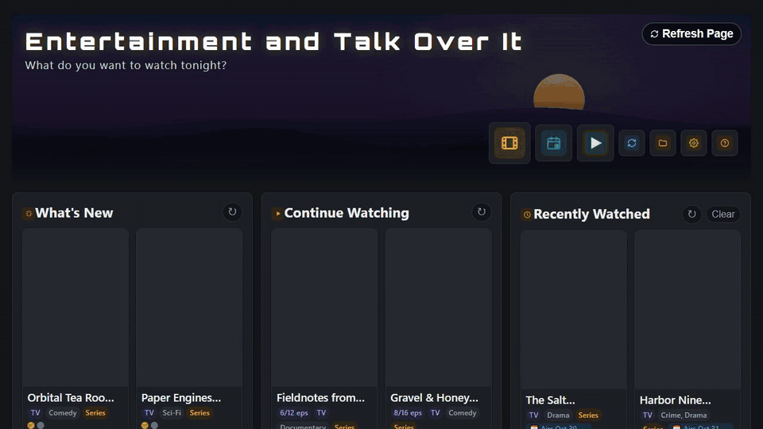
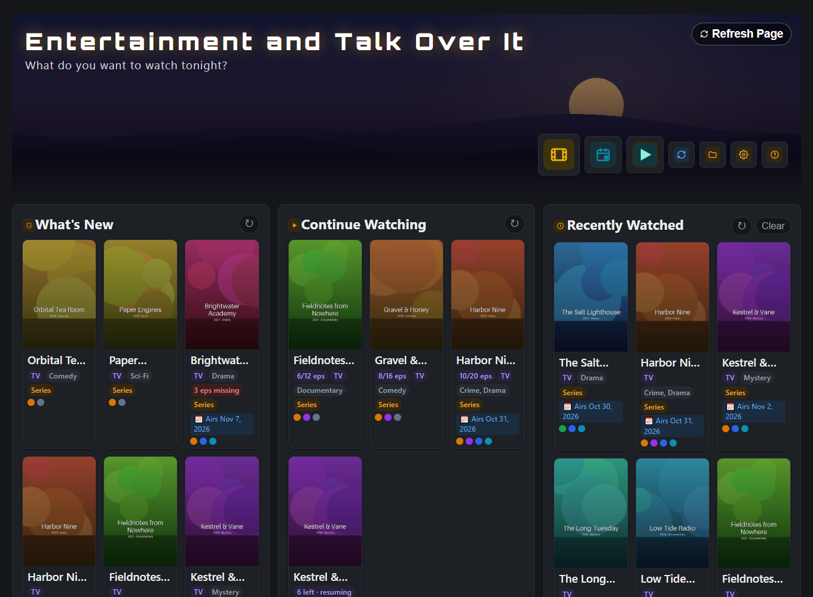
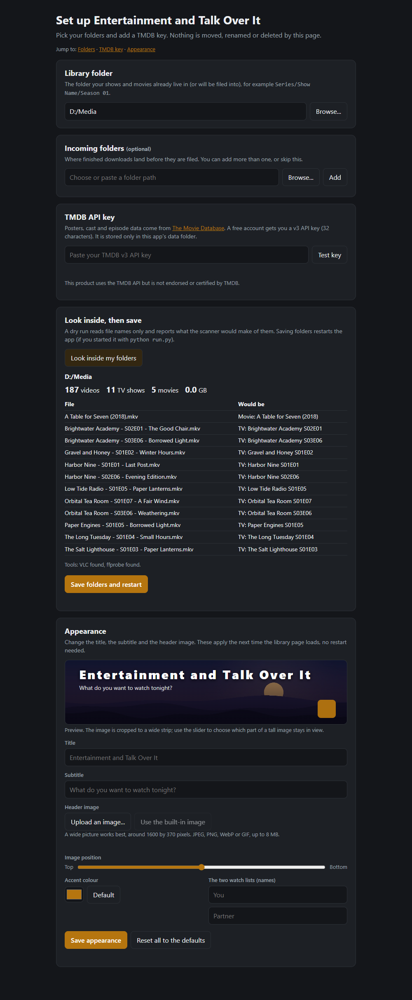
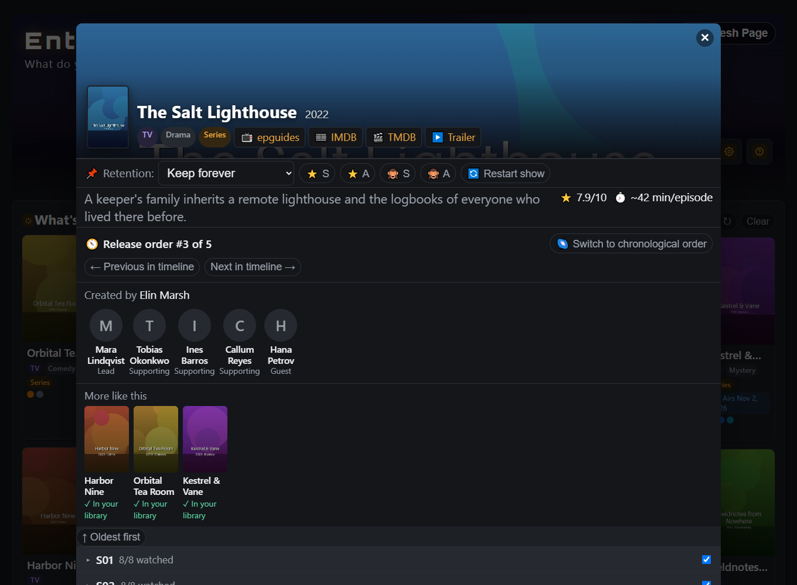
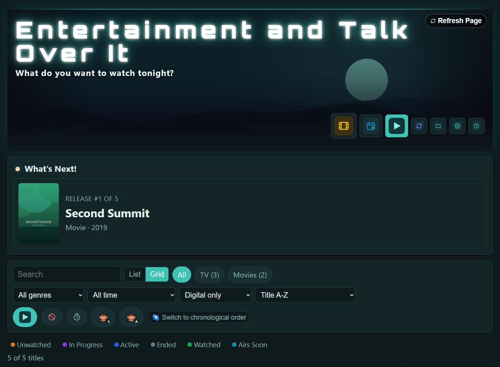
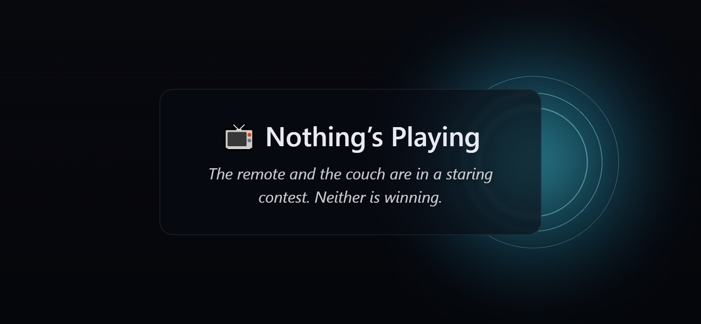
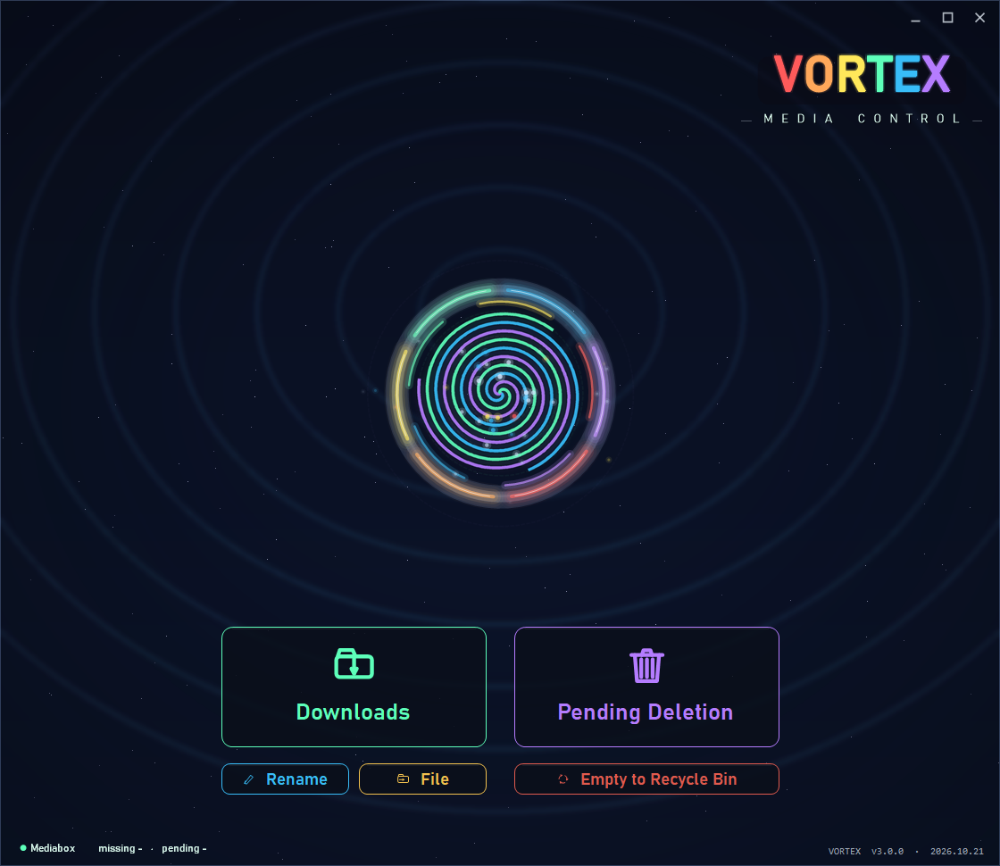
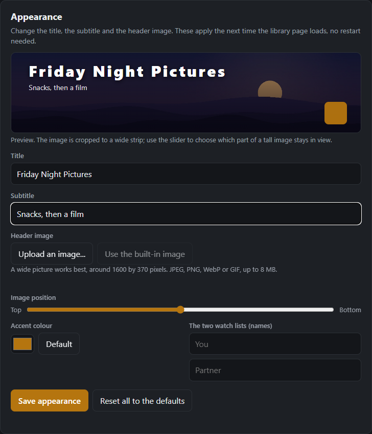

# Entertainment and Talk Over It

_What do you want to watch tonight?_

A browsable catalog for the video files you already own, and the pipeline that keeps it honest: posters, cast,
air dates and watched history for every show and movie in a folder tree, plus a filing flow that never moves
or deletes anything without a plan you can read first. It runs locally (Flask, one page, no build step) on
Windows, macOS and Linux.



<sub>The tour above is recorded by a script ([`tools/record_demo.py`](tools/record_demo.py)) from the demo library,
so it can be re-made with one command. A full-quality version is [`docs/demo.mp4`](docs/demo.mp4). Once GitHub Pages
is switched on, the [`pages` workflow](.github/workflows/pages.yml) also publishes a read-only copy of the demo
you can browse without installing anything.</sub>

Showing it to someone? [`docs/DEMO.md`](docs/DEMO.md) is a five-minute script with the stories and the honest answers.

> The repository folder is called `mediabox`, which is also the prefix of the `MEDIABOX_*` settings.

## Try it in one minute

```bash
git clone <this repo>
cd mediabox
pip install -r requirements.txt
python run.py --demo
```

Open <http://127.0.0.1:5183>. You get a made-up library (sixteen invented titles with generated posters, no
network, no key) so you can click around: search and filters, watched marks that really are saved, the watch
lists, the detail view, the phone remote page, an optional franchise mode. Python 3.11 or newer; the only
dependencies are Flask and Pillow.



## Use it on your own library

```bash
python run.py
```

The first run opens a setup page in your browser:



1. pick your **library folder** (the organised `Series/Show/Season 01/...` tree) and, optionally, one or more
   **incoming folders** (downloads waiting to be filed);
2. paste a free **TMDB API key** and test it live (the key goes to `data/tmdb_api_key.txt`, never into
   `config.json`, and is never echoed back);
3. take a **dry run**: the page reads file names only and shows how many shows and movies it found and what each
   sample file would be recognised as. Nothing is written;
4. **save and start.** The server restarts itself with your settings and begins the first scan.

You can come back to the same page any time: **Admin menu → Settings** (the gear in the header). It is where you change your media folders later, replace the TMDB key, and, on the same page, change the **title, the subtitle and the header image** (with a live preview), the accent colour and the names on the two watch lists. Appearance changes apply on the next page load, no restart. Everything the page does can also be done by hand: see [CONFIG.md](CONFIG.md).

## What you get

| | |
| --- | --- |
| **Catalog** | Grid or list, search, genre/date/source filters, status dots (unwatched, in progress, active, ended, watched, airs soon), runtime-mismatch detection (a wrong match usually has the wrong length). |
| **Watched history** | Per episode, season and movie. *Continue watching*, *what's new*, *recently watched*, and a watch list and "not interested" list for each of two household members. |
| **Missing episodes** | Compares what you own with TMDB's episode lists, with grace for just-aired episodes, and a safety net that refuses to build a to-do list from a season whose titles match nothing. |
| **Filing** | Takes finished downloads from an incoming folder, validates every episode against TMDB data, and files it into the library with consistent names. Retention is *keep forever* or *delete after watching*, which only ever moves files to a `Pending Deletion` folder. |
| **Play on the TV** | A button that starts VLC on the server machine; a phone on the same network gets a landscape transport remote (pause, seek, volume, chapters) on its own port. |
| **Optional** | A franchise mode (an ordered saga with its own palette and a *what's next* panel), a YouTube channel block, a Windows launcher. |



| Franchise mode | Phone remote |
| --- | --- |
|  |  |

### Optional extras

[`extras/`](extras/README.md) holds pieces you can switch on: the YouTube channel block, protocol handlers for
clicking `openvlc://` links from another Windows PC, and **VORTEX**, a small Windows launch-pad (start the app,
open downloads and Pending Deletion, run the Rename and File flows with a picker).



## Make it yours



The quick way is the Settings page above. For anything beyond title, subtitle, header image, accent and names, and to ship a look with the code, use a *pack*. Name, tagline, banner, loading-screen lines, household names and accent colour can all live in a pack: a plain folder.
Copy [`personal.example/`](personal.example/) to `personal/` (git-ignored), keep the files you want to change,
restart. The built-in pack is original artwork generated by [`tools/make_art.py`](tools/make_art.py). Per-library
fixes (a mislabelled season, a movie that belongs inside a show's season list) are data files, not code. See
[CONFIG.md](CONFIG.md).

## How it works, briefly

```
 library folder ──► scan_media ──► enrich_tmdb ──► consolidate ──► ... ──► media_db.json ─┐
 incoming folder ─┘     (names)      (TMDB match)   (duplicates)   (coverage, runtimes)    │
                                                                                           ▼
 user_state.json (watched, retention, lists) ───────────────────────────────► render_page() ──► one self-contained page
```

A refresh runs each step as its own small script, in order, and stops at the first failure. Every step reads and
writes plain JSON files in `data/`. The page is rendered on the server from three real files
([`app/templates/page.html`](app/templates/page.html), [`app/static/app.css`](app/static/app.css),
[`app/static/js/`](app/static/js), fourteen feature files) into one HTML document with the data included; the server adds JSON
endpoints for what a page can't do alone (mark watched, play, file, refresh).
[ARCHITECTURE.md](ARCHITECTURE.md) has the long version.

## How it is tested

About 240 tests, and the interesting ones are the ones that cross boundaries:

| | |
| --- | --- |
| **Pipeline, end to end** | `scan_media → enrich_tmdb → consolidate → enrich_tv_coverage` on an invented library against a **fake TMDB server** ([`tests/fake_tmdb.py`](tests/fake_tmdb.py)): matching, remakes told apart by year, duplicates reported not deleted, missing episodes, idempotence, cache behaviour. No network, no key. |
| **Real browser** | Playwright drives the demo server and the static build: search, the detail view, ticking an episode and checking it reached `user_state.json` after a reload, franchise mode, the phone remote, the setup page. Any JavaScript error fails the test. |
| **Security** | Every state-changing route is enumerated from the URL map and must refuse a missing, wrong or foreign-origin token; the DNS-rebinding guard; the image routes' path rules; embedded data can't close its `<script>` tag. |
| **Safety of file operations** | Filing never overwrites and never deletes, a replaced copy goes to *Pending Deletion* first, a failure leaves the source in place, state follows the file; renames refuse collisions. |
| **Atomic writes** | A transient lock is retried, a permanent one raises and leaves the original intact, concurrent state updates lose nothing. |
| **Repo hygiene** | Fails on personal paths, e-mail addresses, key-shaped strings, branded art, binaries; the published demo page is checked for anything from the machine that built it. |

Writing them found real bugs, now fixed (see the [changelog](CHANGELOG.md)): a file or title containing
`</script>` could break out of the page's data block; every TV show was re-fetched from TMDB on every refresh
because a cache marker was never saved; and scripts crashed on a fresh clone because the data folder didn't exist.

## Engineering notes

Five things in here were harder than they look.

**Picking the right TMDB title.** Title similarity alone is wrong in predictable ways: a query for a cooking show
scores 0.96 against an obscure namesake and 0.87 against the show everyone means. The matcher adds a year bonus
(exact, off by one, or a decade out), a log-scaled popularity nudge capped at 0.20 (large enough to settle a close
spelling call, far too small to beat a real title match), and refuses anything under 0.45 similarity. When the top
two results are *both* near-exact titles and within 0.05 of each other (a cancelled original and its reboot), it
still picks one, but reports the runner-up so a caller that can ask a human (the rename flow) offers both instead of
guessing. See `best_match` in [`pipeline/enrich_tmdb.py`](pipeline/enrich_tmdb.py) and
[`tests/test_matching.py`](tests/test_matching.py).

**Atomic-write contracts.** Several processes touch the same JSON files while the page is open. Every writer builds
a temp file and swaps it in with `os.replace`, so a reader sees the old file or the new one, never half of one. On
Windows a swap can fail because another process holds a read handle at that exact instant; one shared helper
retries with backoff and then raises loudly rather than swallowing it. Shared state (`user_state.json`) goes
through a single lock-guarded read-modify-write, so concurrent requests can't lose each other's updates. See
[`pipeline/atomic_write.py`](pipeline/atomic_write.py), [`app/state_store.py`](app/state_store.py) and
[`tests/test_atomic_writes.py`](tests/test_atomic_writes.py).

**DPI-aware window placement (Windows).** Watch pages open in a browser window placed on the same monitor as the
app, at half the work area. Python is DPI-unaware, so on a scaled display it is told a 3840x2160 screen is
1920x1080; Chrome is DPI-aware and reads real pixels, so the window landed in the wrong place at the wrong size. The
placement now runs on a thread switched to per-monitor-v2 awareness for the duration of the call, so both sides
speak real pixels. See `_left_half_rect` and the launch wrapper in [`app/web_server.py`](app/web_server.py).

**The YouTube premiere bug.** A premiere is a live stream for half an hour, then an ordinary video. While it airs,
its watch page reports no usable duration, so it looked like a Short, and Shorts are excluded for good. Whole series
vanished from the feed. Burying a video now takes two independent signals to agree, and anything that was ever live
is deferred and re-checked instead. See [`extras/youtube/`](extras/youtube/).

**Loading progress that tells the truth.** The refresh is a list of steps of wildly different lengths, so a bar
that moves one notch per step lies. Each step is weighted by the rolling average of its last five real durations,
and a long step can report "412 of 567 titles" through a tiny progress file (the steps are subprocesses, so the
server can't see inside them). The server ignores a progress file that isn't from the step running right now. See
[`pipeline/step_progress.py`](pipeline/step_progress.py).

## Platforms

Developed on Windows. The core (scanner, matcher, filing, the page, the server, the setup page, demo mode, VLC
remote) is plain Python and CI runs the test suite on Windows, macOS and Linux. The author has run it locally only
on Windows: macOS and Linux are covered by CI and have not been used by hand. Windows-only extras are kept out of
the way in [`extras/`](extras/): the VORTEX launcher, protocol handlers, and popup window placement (which switches
itself off elsewhere). The portable "travel" export from the original build is not part of this release.

## Develop

```bash
pip install -r requirements-dev.txt
python -m pytest                              # unit, security, pipeline; browser tests run if Playwright is installed
python tools/build_static_demo.py             # the read-only demo site, into site/
python tools/capture_screenshots.py           # regenerates docs/screenshots (needs playwright + Chrome)
python tools/record_demo.py                   # re-records docs/demo.gif (needs ffmpeg)
```

See [CONTRIBUTING.md](CONTRIBUTING.md). CI ([`ci.yml`](.github/workflows/ci.yml)) runs the suite on three operating
systems and several Python versions, the browser tests in Chromium, compiles the C# extras, lints for syntax errors
and Python 3.11 compatibility, and scans for secrets with gitleaks.

## Licence and credits

MIT, see [LICENSE](LICENSE). This product uses the TMDB API but is not endorsed or certified by TMDB. The Orbitron
font (SIL OFL 1.1) is embedded for the wordmark. Details in [NOTICE.md](NOTICE.md). Security notes:
[SECURITY.md](SECURITY.md).
